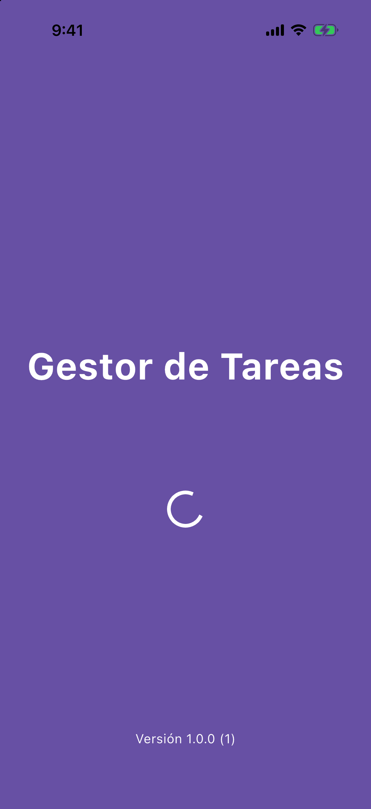
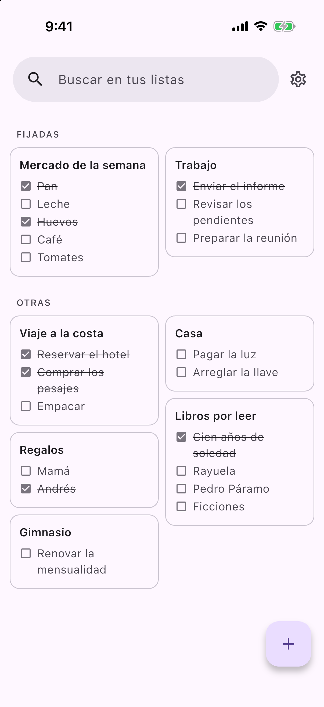
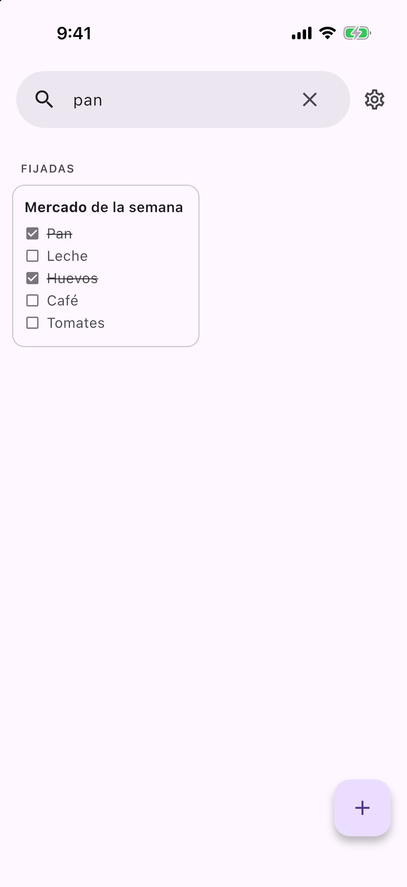
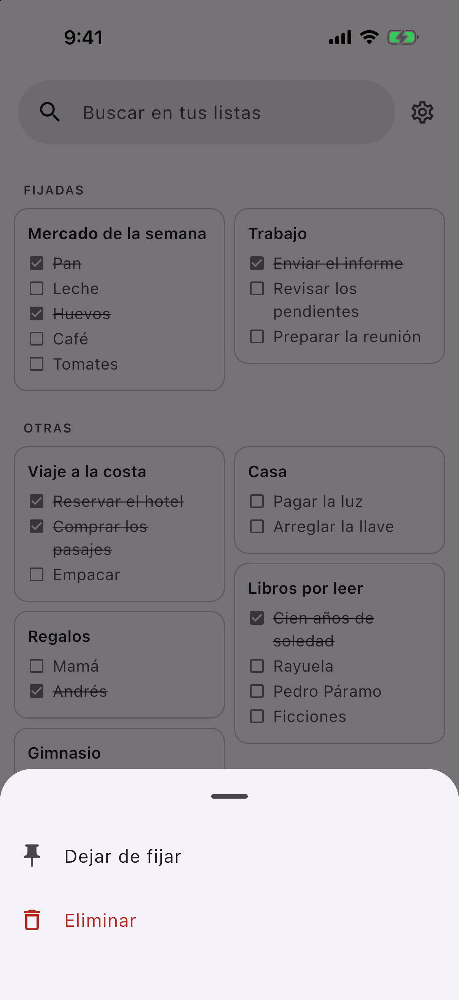
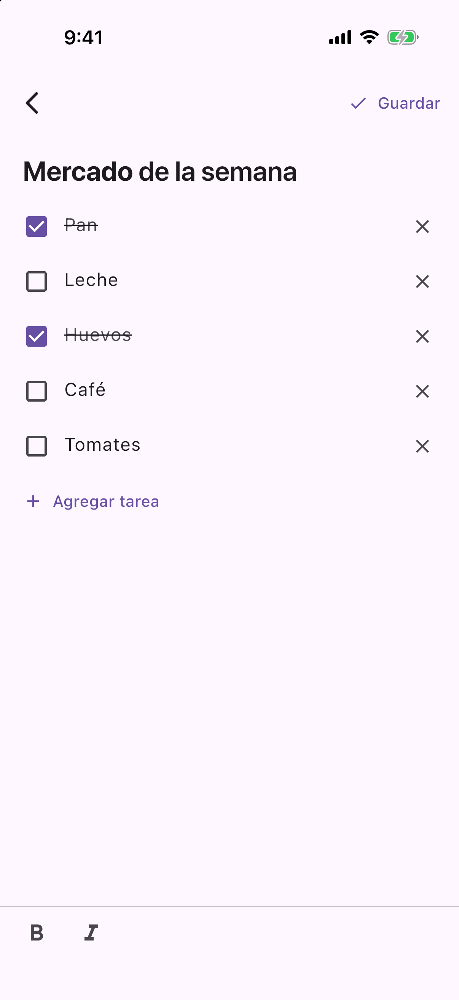
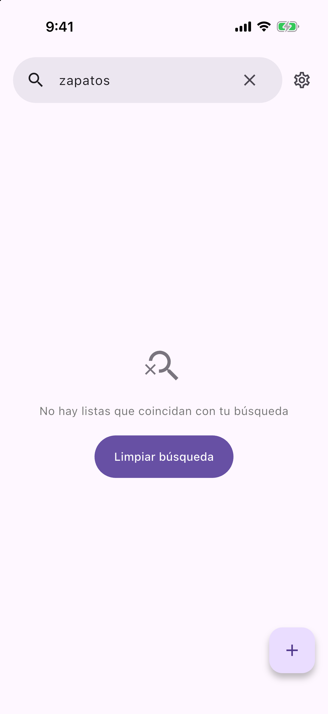
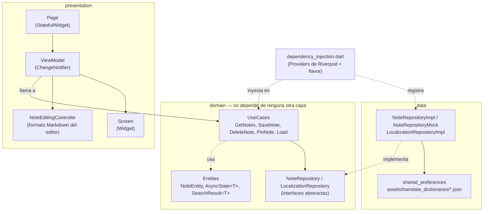

# Gestor de Tareas

App Flutter de **listas de tareas al estilo Google Keep**: buscas, fijas y eliminas listas, y al abrirlas marcas las tareas hechas, que quedan tachadas. Para modificarlas tocas Editar, y desde Ajustes eliges si eso hace falta y si los cambios se guardan solos.

## ¿Qué hace?

- **Listas** en dos columnas de alto libre, con una barra de búsqueda arriba y cada tarea con su estado. Las fijadas salen primero, en la sección "FIJADAS", y el resto en "OTRAS".
- **Búsqueda** por título o texto de las tareas mientras escribes, sobre las listas ya cargadas.
- **Mantener presionada una lista** abre un menú para **fijarla** (máximo 5) o **eliminarla**.
- **Vista previa**: al abrir una lista se ven el título y las tareas, y solo se pueden marcar. Marcar se guarda de una.
- **Editor**: al tocar **Editar** aparecen los campos, agregar y eliminar tareas y la barra de formato. **Guardar** vuelve a la vista previa. Las listas nuevas abren editando. Una lista puede tener solo título o solo tareas, pero no puede quedar vacía.
- **Ajustes**: desde el engranaje del home se activa o no el **autoguardado** (activo por defecto) y **tocar Editar para modificar** (activo por defecto; si se apaga, las listas abren editando).
- **Tareas hechas**: al marcar el check, la tarea se tacha. El tachado solo viene del check, no es un formato de texto.
- **Guardado automático**: con el autoguardado activo, la lista se guarda sola 800 ms después del último cambio, y también al salir. Sin él, solo se guarda con **Guardar**, y si sales con cambios se pregunta si guardarlos o descartarlos.
- **Formato** con una barra de botones: negrita y cursiva, por ahora solo en el título. Las marcas de formato no se ven, igual que en Keep.
- **Estado global**: las listas se cargan al abrir el home y se actualizan solas al crear, editar, fijar o eliminar, sin recargar.

Proyecto construido con **Clean Architecture** (domain / data / presentation), MVVM en la capa de presentación, **Riverpod** para estado global e inyección de dependencias, **go_router** para la navegación y **flavors** (`mock`, `dev` y `prod`).

## Capturas

| Splash | Lista de notas | Búsqueda |
|:---:|:---:|:---:|
|  |  |  |

| Opciones al mantener presionado | Editor con formato | Búsqueda sin resultados |
|:---:|:---:|:---:|
|  |  |  |

## Requisitos previos

| Herramienta | Versión |
|---|---|
| Flutter | `3.47.x` (canal stable; desarrollado con `3.47.5`) |
| Dart SDK | `^3.13.4` (definido en `pubspec.yaml`) |
| Xcode + CocoaPods | Solo para correr en iOS |
| Android Studio / Android SDK | Solo para correr en Android |

Verificar el entorno con:

```bash
flutter doctor
```

No se necesita ningún API key ni archivo `.env`: las notas se guardan en el dispositivo con `shared_preferences`.

## Cómo ejecutarlo

1. Clonar el repositorio:

   ```bash
   git clone https://github.com/marlonc98/pragma_road_1.git
   cd pragma_road_1
   ```

2. Instalar dependencias (como `pubspec.lock` no se versiona, este paso resuelve las versiones según los rangos de `pubspec.yaml`):

   ```bash
   flutter pub get
   ```

3. Correr la app con un flavor:

   ```bash
   flutter run --flavor mock
   ```

   En VS Code también se puede elegir el flavor desde **Run and Debug**: [.vscode/launch.json](.vscode/launch.json) tiene una configuración por flavor.

### Flavors

| Flavor | Nombre de la app | Notas |
|---|---|---|
| `mock` | [MOCK] Gestor de Tareas | En memoria, con 68 notas de ejemplo para probar la lista con muchos elementos. Se pierden al cerrar la app. |
| `dev` | [DEV] Gestor de Tareas | Guardadas en el dispositivo con `shared_preferences`. |
| `prod` | Gestor de Tareas | Guardadas en el dispositivo con `shared_preferences`. |

Cada flavor tiene su propio `applicationId` / `bundleId` (`.mock`, `.dev`), así que los tres se pueden instalar a la vez. Si se corre sin `--flavor`, la app usa `prod`. El repositorio de cada flavor se elige en [dependency_injection.dart](lib/dependency_injection.dart).

## Cómo contribuir

Los commits siguen [Conventional Commits](https://www.conventionalcommits.org/) en inglés (`feat(notes): ...`, `fix(note-editor): ...`). Antes de abrir un PR:

```bash
dart format lib test
flutter analyze
flutter test
```

## Estructura de carpetas y arquitectura

El código en `lib/` está organizado en tres capas, siguiendo la regla de dependencia de Clean Architecture: `domain` no conoce a `data` ni a `presentation`; las otras dos capas dependen de `domain`, nunca al revés.



```
lib/
├── domain/              # Reglas de negocio puras, sin Flutter ni detalles de almacenamiento
│   ├── entities/         # NoteEntity, AsyncState<T>, SearchResult<T>
│   ├── repositories/     # Contratos abstractos (NoteRepository, LocalizationRepository)
│   ├── use_cases/        # Una operación de negocio por clase (note/, load_use_case.dart)
│   ├── states/           # Contratos de estado global (LocalizationState, NotesState, SettingsState)
│   └── constants/        # Claves de error compartidas (ErrorsConstants)
│
├── data/                # Implementaciones concretas de los contratos de domain
│   ├── dto/              # NoteDto y TaskDto: formato guardado y conversión con las entidades
│   └── repositories/
│       ├── note/          # NoteRepositoryImpl (shared_preferences) + api/, y NoteRepositoryMock
│       └── localization/  # LocalizationRepositoryImpl + api/
│
├── presentation/        # UI + estado de UI
│   ├── pages/            # Cada pantalla: Page + Screen + ViewModel (+ widgets/ propios)
│   │   ├── splash/        # Carga traducciones, ajustes y versión, luego va a la lista
│   │   ├── notes/         # Lista con carga inicial, búsqueda, fijadas y opciones
│   │   ├── note_editor/   # Vista previa y edición, con guardado y barra de formato
│   │   └── settings/      # Ajustes: autoguardado y tocar Editar
│   ├── widgets/          # Reutilizables: buttons/ y loaders_status/ (carga, error, sin resultados)
│   ├── helpers/          # FunctionsHelper: espera a que se termine de escribir
│   ├── states/           # Implementaciones Riverpod de los estados
│   ├── utils/            # ViewModel base + StfViewModelAdapter
│   ├── constants/        # TextConstants (claves de traducción) y MarkdownConstants
│   ├── router.dart       # Rutas con go_router
│   └── app.dart          # MaterialApp.router
│
├── flavors/flavors.dart       # Flavor actual y nombre de la app por flavor
├── dependency_injection.dart  # Todos los Providers (repositorios, estados y casos de uso)
└── main.dart                  # Punto de entrada: lee el flavor y envuelve la app en ProviderScope

assets/translate_dictionaries/  # Traducciones (es.json)
test/                           # Tests del repositorio, estado, casos de uso, pantallas y controller del editor
```

### Capas

- **domain**: define *qué* hace la app. Por ejemplo, `PinNoteUseCase` revisa que no haya más de 5 notas fijadas antes de fijar otra, sin saber que por debajo hay `shared_preferences`.
- **data**: define *cómo* se guardan los datos. Cambiar `shared_preferences` por un backend solo requiere otra implementación de `NoteRepository` y cambiar su Provider.
- **presentation**: dibuja la UI y reacciona a los cambios. Los `ViewModel` llaman casos de uso a través de los Providers, nunca a los repositorios directamente.

### Inyección de dependencias con Riverpod

[dependency_injection.dart](lib/dependency_injection.dart) declara todos los `Provider`/`NotifierProvider`, agrupados en repositorios, estados y casos de uso. `noteRepositoryProvider` elige la implementación según el flavor: `NoteRepositoryMock` en `mock` y `NoteRepositoryImpl` en `dev` y `prod`.

### Patrón de cada pantalla (Page / Screen / ViewModel)

- **`*_page.dart`**: `StatefulWidget` con su `route` estática; solo crea el `ViewModel` vía `StfViewModelAdapter`.
- **`*_page_view_model.dart`**: extiende `ViewModel<T>` (un `ChangeNotifier` con acceso a `context` y `WidgetRef`), llama a los casos de uso y expone el estado a la UI.
- **`*_page_screen.dart`**: widget que recibe el `ViewModel` y solo dibuja UI.

### Manejo de resultados asíncronos: `AsyncState<T>`

Los repositorios devuelven [AsyncState<T>](lib/domain/entities/petition_status_entity.dart): un wrapper con `status` (`notStarted` / `loading` / `complete` / `failed`), `data` y `error`. Los errores se muestran traducidos a partir de las claves de [ErrorsConstants](lib/domain/constants/errors_constants.dart).

### Cómo se guardan las notas

[NoteRepositoryImpl](lib/data/repositories/note/note_repository_impl.dart) usa `shared_preferences`, con una función por operación en `data/repositories/note/api/`:

- **Una clave por nota**: cada nota se guarda como JSON en `sp_note_{id}`, así se accede directo a una nota por su id.
- **Fijadas**: solo se guarda la lista de ids en `sp_pinned_notes`. Al cargar, la API marca qué notas están fijadas.
- **Tareas**: se guardan dentro de la nota, en `content`, cada una con `id`, `content` y `completed`. Las notas viejas, con el contenido como texto, se leen convirtiendo cada renglón en una tarea, y un renglón todo con `~~` en una tarea completada.
- **Lectura**: `getNotes` devuelve todas las notas completas, de la más reciente a la más antigua.

### Estado de las notas

`notesStateProvider` ([NotesStateImpl](lib/presentation/states/notes_state_impl.dart), un `Notifier` de Riverpod) tiene todas las notas en memoria. Es la única fuente de la que lee la UI:

- **Carga inicial**: `NotesPageViewModel` llama a `GetNotesUseCase` al abrir el home, que llena el estado. Mientras tanto se ve la ruedita de `LoaderScreenWidget`.
- **Cambios**: `SaveNoteUseCase`, `DeleteNoteUseCase` y `PinNoteUseCase` guardan en el repositorio y, solo si sale bien, actualizan el estado. Domain conoce únicamente la interfaz [NotesState](lib/domain/states/notes_state.dart), igual que con `LocalizationState`.
- **Lectura**: `NotesPageScreen` hace `ref.watch` del estado y se redibuja sola. La búsqueda filtra en memoria, las tarjetas muestran hasta 10 tareas con `...`, y el editor recibe la nota completa desde el estado.

### Ajustes

`settingsStateProvider` ([SettingsStateImpl](lib/presentation/states/settings_state_impl.dart)) tiene los ajustes en memoria. `LoadUseCase` los carga en el splash, para que estén listos antes de abrir cualquier lista, y `SaveSettingsUseCase` los guarda en `shared_preferences` y actualiza el estado. Si la carga falla, quedan los valores por defecto.

| Autoguardado | Tocar Editar | Al abrir una lista | Guardar |
|---|---|---|---|
| Sí | Sí | Vista previa | Termina de editar; los cambios ya se fueron guardando |
| No | Sí | Vista previa | Guarda los cambios y vuelve a la vista previa |
| Sí | No | Editando | No hay botón |
| No | No | Editando | Guarda y sigue editando |

### Editor

- **Guardado automático con debounce**: cada cambio reinicia un temporizador de 800 ms y solo se guarda cuando dejas de escribir. Los guardados se encadenan para que una actualización nunca se adelante a la creación.
- **Filas de tareas**: cada tarea tiene su propio campo. Enter crea otra debajo, y las filas vacías no se guardan.
- **Tachado**: se aplica como estilo del campo cuando la tarea está completada. No hay marca de tachado en el texto, para no confundirlo con una tarea hecha.
- **Tareas en edición**: [TaskRowWidget](lib/presentation/pages/note_editor/widgets/task_row_widget.dart) usa un `TextFormField` sin controller y avisa de la edición cuando pasan 500 ms sin escribir, con [FunctionsHelper](lib/presentation/helpers/functions_helper.dart).
- **Formato Markdown**: la barra inserta `**negrita**` y `_cursiva_` en el título. Cada formato usa un carácter distinto para que sus marcas nunca se confundan aunque queden pegadas.
- [NoteEditingController](lib/presentation/pages/note_editor/controllers/note_editing_controller.dart) hace que el editor se comporte como Keep:
  - Interpreta las marcas con un parser de pila y las dibuja invisibles y sin ancho.
  - El cursor y el borrado se saltan las marcas.
  - Respeta el autocompletado del teclado.

### Internacionalización

> **Hoy la app está solo en español (`es`).**

Los textos visibles usan claves de [TextConstants](lib/presentation/constants/text_constants.dart), y las traducciones viven en `assets/translate_dictionaries/<locale>.json`. Al agregar un texto nuevo, la clave debe ir en `TextConstants` y en **cada** JSON de idioma.

#### Variables dentro de las traducciones

Algunas constantes de `TextConstants` tienen un comentario al final. Ese comentario lista las palabras que se pueden enviar en `values` para que el sistema las inserte como variables en el texto:

```dart
static const versionAndBuild = "versionAndBuild"; //version,build
```

En el JSON, cada variable va entre llaves:

```json
"versionAndBuild": "Versión {version} ({build})"
```

Y al traducir se envían con esos mismos nombres. `translate` reemplaza cada `{clave}` por su valor:

```dart
i18n(TextConstants.versionAndBuild, values: {'version': '1.0.0', 'build': '1'});
// Versión 1.0.0 (1)
```

Si una constante no tiene comentario, su texto no recibe variables.

## Paquetes principales

| Paquete | Para qué se usa | Por qué está |
|---|---|---|
| `flutter_riverpod` / `riverpod` | Estado global e inyección de dependencias | Es el mecanismo central de la arquitectura: repositorios, estados y casos de uso se declaran como Providers. |
| `go_router` | Navegación entre splash, lista y editor | Rutas declarativas (`context.go` / `context.push`). El editor recibe la nota con `extra`. |
| `shared_preferences` | Persistencia local de clave-valor | Guarda las notas (una clave por nota) y los ids de las fijadas en los flavors `dev` y `prod`. También lo usa la localización para el idioma guardado. |
| `flutter_staggered_grid_view` | Grilla de dos columnas de alto libre | `SliverMasonryGrid` mantiene las columnas estilo Keep en el mismo scroll que las fijadas y solo construye las tarjetas visibles. |
| `package_info_plus` | Leer la versión y el número de build | Se muestran en el splash (`Versión {version} ({build})`). |
| `flutter_flavorizr` (dev) | Generar los flavors `mock`, `dev` y `prod` | Configura Android e iOS (ids, nombres, esquemas de Xcode) desde `pubspec.yaml`. Está configurado para no tocar `main.dart`, `app.dart` ni los íconos. |
| `flutter_test`, `flutter_lints` (dev) | Tests y reglas de análisis estático | |

### Por qué no hay paginación

Todas las notas se cargan al abrir el home porque el estado global es la fuente de la UI. Paginar no ahorraría lecturas: `shared_preferences` carga todo al abrirse y las notas se guardan en claves separadas, así que ordenarlas por fecha ya obliga a leerlas todas. El dibujo sí es perezoso, gracias a `SliverMasonryGrid`.

## Archivos que no se versionan

El [.gitignore](.gitignore) excluye todo lo que es local a la máquina o sensible:

- **Generados / locales**: `build/`, `.dart_tool/`, `.idea/`, `*.iml`, `.metadata`, `pubspec.lock`, `Podfile.lock`, `Pods/`, `xcuserdata/`, `local.properties`, `.vscode/settings.json`.
- **Credenciales**: `.env` / `.env.*` (se permite `.env.example`), `key.properties`, keystores (`*.jks`, `*.keystore`), certificados y perfiles de iOS (`*.p12`, `*.p8`, `*.mobileprovision`), `google-services.json` y `GoogleService-Info.plist`.

## Limitaciones conocidas / próximos pasos

- La app está solo en español (`es`).
- Las notas del flavor `mock` viven en memoria y se pierden al cerrar la app.
- El editor no se cierra con el gesto de deslizar hacia atrás de iOS, para poder guardar lo pendiente antes de salir; se sale con el botón de la barra superior.
- Las tareas se marcan desde el editor; en la lista solo se ve su estado.
- La captura del editor es de la versión anterior, de texto libre.
- Las notas guardadas con la cursiva vieja (`*texto*`) ya no se ven en cursiva.
